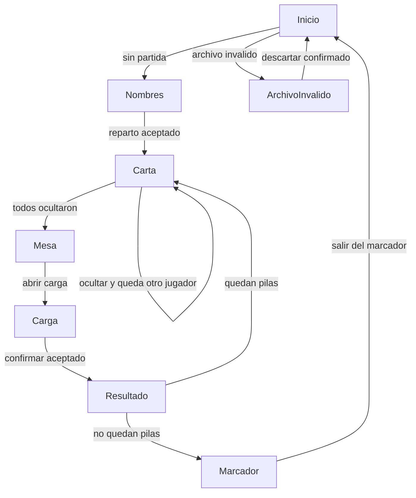

# Navegación del modo presencial

Especificación revisable, registrada como OOC-015.5. No agrega rutas, pantallas ni librerías. El flujo de juego está en [MODO_PRESENCIAL.md](MODO_PRESENCIAL.md), la forma del documento en [ARQUITECTURA_PRESENCIAL.md](ARQUITECTURA_PRESENCIAL.md) y el ciclo de vida en [PERSISTENCIA_PRESENCIAL.md](PERSISTENCIA_PRESENCIAL.md). La épica es OOC-015 en `docs/BACKLOG.md`.

## Qué se reutiliza

Hay un solo `NavigationContainer` y el stack de `mobile/src/navigation/AppNavigator.tsx`. Los parámetros de ruta siguen vacíos, como en `mobile/src/navigation/routes.ts`: la carta, el voto y el nombre no viajan en la ruta. `useAppNavigation`, `Button`, `Heading`, `HelperText` y `screenStyles` se pueden usar cuando existan las pantallas.

No se reutilizan `SecretCardScreen`, `ConversationScreen`, `VotingScreen`, `ResultsScreen`, `ScoreboardScreen` ni `LobbyScreen`: leen el token y el socket de un solo miembro. `ScreenPlaceholder` avanza con «Continuar» sin mirar una fase y no sirve para este flujo. `GuestSessionProvider` y `RoomConnectionProvider` siguen envolviendo el navegador para el online. Las pantallas locales no se suscriben a ese socket ni leen `ooc.guest.session`.

## Pantallas

Cada fase de la interfaz tiene una pantalla. Si la ruta no coincide con la fase del documento, se reemplaza la ruta por la de esa fase y no se dibuja la carta ni el voto de la ruta equivocada. El cambio de fase deja una sola ruta en el stack: el atrás no puede volver a la carta del jugador anterior.

- Inicio, la `Home` ya existente. Sin archivo local ofrece la entrada al presencial, además de crear sala, unirse y componentes. El rótulo de esa entrada no está definido.
- Nombres, fase `setup`. Anota de 4 a 8 nombres en el orden guardado. No muestra cartas ni reparte hasta que el módulo de partida acepte la lista y haya catálogo.
- Carta, fase `viewing`. Un jugador. Número y texto solo si el documento dice que la carta está visible y la decisión de producto permite mostrarla. Ocultar es una acción explícita. El siguiente jugador solo después de ocultar. No muestra descarte, rol ni otra mano.
- Mesa, fase `conversation`. Sin carta en pantalla. Una acción explícita abre la carga. No hay manos, «¡Basta!» ni cuenta regresiva.
- Carga, fase `recording`. Borradores editables de quien ya tiene una elección aceptada. Confirmar solo si el módulo acepta todas las elecciones juntas. No confirma dos veces.
- Resultado, fase `results`. La ronda ya puntuada: nombre, carta, gesto, señalados, puntos y una explicación. No vuelve a puntuar.
- Marcador final, fase `finished`. Totales y quienes empatan en el máximo. No hay revancha ni ronda siguiente.
- Aviso de archivo inválido. No es una fase. Explica que no se puede reanudar. El archivo sigue hasta descartarlo. No reparte una partida encima.

## Transiciones válidas

La pantalla no ofrece saltar de nombres a mesa, de carta a carga, de mesa a resultado ni de carga a la carta del siguiente. Tampoco abrir la ronda siguiente con la anterior sin puntuar, ni abrirla si no alcanzan las pilas. Ocultar no revela al siguiente en el mismo paso. El orden de la pasada es el orden guardado de los nombres. El reglamento no confirma que ese sea el orden de la mesa.

## Al iniciar

Sin archivo, se abre Inicio. El online no se entera.

Con versión 1 aceptada, se abre la pantalla de la fase guardada. No se reparte de nuevo ni se vuelven a calcular puntos ya confirmados.

Con un archivo ilegible, de otra versión o incoherente, se muestra el aviso y no se entra a una fase. Una sesión de invitado que ya exista no se borra ni se usa para esta partida.

## Confirmación

No hay deshacer. Piden confirmación antes de borrar progreso aceptado: abandonar la partida activa, y descartar un archivo inválido. Reiniciar es el mismo efecto que abandonar y crear otra. Si esa acción pide su propio diálogo sigue pendiente en la persistencia.

No piden este diálogo: ocultar la carta, abrir la carga, confirmar el voto y pasar a la ronda siguiente. Salir del marcador final borra el archivo según la recomendación ya escrita. Un diálogo extra ahí no está decidido.

Inicio y el atrás del sistema, con una partida activa, no están decididos. Si solo vuelven a Inicio y dejan el archivo, la partida se reanuda al abrir de nuevo y no hace falta confirmación. Si equivalen a abandonar, borran el archivo y sí la piden. Esta especificación no elige una de las dos.

## Vacíos, errores y recuperación

Con la lista de nombres vacía se puede anotar y no se reparte. Con menos de 4, más de 8, un nombre vacío, de más de 80 caracteres o repetido, el módulo lo rechaza y la pantalla sigue en nombres. Sin catálogo de 15 o 16 situaciones no se reparte. La carta oculta no muestra número ni texto. La mesa no muestra manos. Si en la carga falta una elección válida, no se confirma. Una elección inválida no entra al archivo. Si la escritura se corta, queda el documento anterior. Ante un archivo inválido, el aviso permite descartarlo después de confirmar, y eso vuelve a Inicio. El resultado y el marcador no se recalculan. Este modo no tiene reintento de red.

## Privacidad

La carta de otro jugador no se dibuja en nombres, carta, mesa ni durante el cambio de ruta. En resultado y marcador final solo entra la ronda ya revelada. Qué hacer si el proceso murió con la carta visible, si quien ya la ocultó puede verla otra vez, y si la carga muestra cartas además de gestos, siguen pendientes: la navegación no elige por su cuenta. Al reanudar `viewing` con la carta guardada como oculta no se muestra número ni texto hasta una acción explícita. Al reanudar la carga, la cubierta «continuar» antes de mostrar borradores sigue pendiente.

## Diferencias con el online

El online va de Inicio a crear o unirse, lobby, carta, conversación, votación, resultados y marcador, empujando rutas según el servidor. Cada teléfono es un jugador. «Inicio» vacía el stack y no borra la sala. El presencial no tiene código, lobby, mano ni cuenta regresiva. Una sola lista de nombres pasa por carta, mesa y carga. La fase local manda sobre la ruta. El online puede seguir existiendo en la misma aplicación. Sus pantallas no muestran el documento local.

## Pendiente

- Rótulos de la entrada presencial, ocultar, abrir carga, ronda siguiente, abandonar, reiniciar y descartar.
- Si Inicio o el atrás abandonan o solo dejan el archivo.
- Si reiniciar y salir del marcador final piden diálogo.
- Carta visible al reanudar, volver a ver una carta ya oculta, y si la carga muestra cartas.
- Si al abrir con partida válida se puede llegar al online sin abandonar. La persistencia abre la fase guardada.
- Si el socket de una sesión de invitado ya abierta debe quedar quieto mientras se mira la partida local. Las pantallas locales no lo usan.
- Siguen abiertos, y esta navegación no los cierra: el catálogo, comprobar `L × 2 > N`, señalar a tres o más, el orden visual del marcador, quién confirma y el orden de la mesa.
