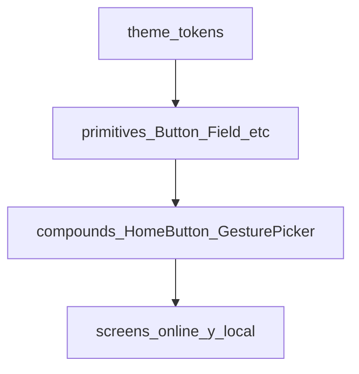

# Plan de rediseño UI/UX — Out Of Context

**Historia:** OOC-020.1 — Auditoría visual y plan de migración UI/UX  
**Fecha:** 2026-10-18  
**Alcance de este documento:** auditoría del frontend actual, propuesta de design system, plan incremental, assets faltantes y riesgos.  
**No implementa código.** No elimina componentes. No cambia reglas de negocio. No introduce dependencias.

Identidad aprobada (producto): paleta **menta, navy, crema, amarillo y coral**; tipografía **redondeada**; ilustraciones **cartoon**. Las pantallas deben ser **nativas reales** (React Native), no imágenes estáticas usadas como pantalla completa.

---

## 1. Objetivo y restricciones

### Objetivo

Sustituir la UI funcional/minimal actual por una identidad visual coherente, manteniendo los flujos online y presencial ya implementados, con componentes nativos y tokens centralizados.

### Restricciones

- No usar PNG/JPG a pantalla completa como “pantalla”.
- No inventar funcionalidades que no existan en el código o el backlog.
- No cambiar reglas de puntuación, revelación, votación ni contratos API/WebSocket.
- Preservar los contratos UX de OOC-019.6 / .8 / .9 (pase privado, carga sin roles, resultados post-confirmación, CTAs de cierre).
- Hex exactos y familia tipográfica exacta quedan **pendientes del kit de marca**; este documento usa **tokens semánticos nombrados**.

### Fuentes consultadas

- Código: `mobile/src/` (screens, components, theme, navigation, hooks, services, features/local).
- Docs: `GAME_DESIGN_DOCUMENT.md`, `ARCHITECTURE.md`, `BACKLOG.md`, `UX_AUDIT.md`, `OOC-019_REGRESSION_REPORT.md`, navegación/persistencia presencial.

---

## 2. Auditoría del estado actual

### 2.1 Estructura del frontend

```
mobile/src/
  app/           GuestSessionProvider, RoomConnectionProvider
  components/    primitivos + controles locales
  config/        env
  features/local catalog, match, rules (sin componentes UI propios)
  hooks/         useAppNavigation
  navigation/    AppNavigator, routes
  screens/       15 pantallas
  services/      api/, realtime/, session/
  theme/         theme.ts
  types/
```

Navegación: un solo native-stack; parámetros de ruta vacíos (no viajan token, carta ni puntos).

### 2.2 Pantallas (15)

| Ruta | Archivo | Modo | Rol |
|---|---|---|---|
| `Home` | `HomeScreen.tsx` | Hub | Entrada online + presencial + recovery |
| `CreateRoom` | `CreateRoomScreen.tsx` | Online | Crear sala |
| `JoinRoom` | `JoinRoomScreen.tsx` | Online | Unirse |
| `Lobby` | `LobbyScreen.tsx` | Online | Lobby |
| `SecretCard` | `SecretCardScreen.tsx` | Online | Carta secreta |
| `Conversation` | `ConversationScreen.tsx` | Online | Conversación |
| `Voting` | `VotingScreen.tsx` | Online | Votación |
| `Results` | `ResultsScreen.tsx` | Online | Resultados de ronda |
| `Scoreboard` | `ScoreboardScreen.tsx` | Online | Marcador |
| `Catalog` | `CatalogScreen.tsx` | Dev | Showcase de componentes |
| `LocalSetup` | `LocalSetupScreen.tsx` | Presencial | Nombres 4–8 |
| `LocalCard` | `LocalCardScreen.tsx` | Presencial | Pase de carta |
| `LocalTable` | `LocalTableScreen.tsx` | Presencial | Mesa |
| `LocalRecord` | `LocalRecordScreen.tsx` | Presencial | Carga de gestos |
| `LocalResults` | `LocalResultsScreen.tsx` | Presencial | Resultados / marcador |

No hay pantallas huérfanas ni rutas sin screen.

### 2.3 Componentes (`mobile/src/components/`)

| Componente | Uso principal |
|---|---|
| `Button` | CTAs (primary / secondary / destructive) |
| `TextField` | Inputs con error |
| `Heading`, `HelperText` | Jerarquía de texto |
| `Message` | Alertas error / warning |
| `EmptyState` | Vacío (poco usado fuera de Setup/Catalog) |
| `ContentCard` | Contenedor con elevación (sobre todo local) |
| `StatusBadge` | Roles en resultados locales + Catalog |
| `LoadingIndicator` | Solo demo Catalog; pantallas reales usan “Cargando” en HelperText |
| `ConfirmAction` | Modales de confirmación |
| `screenStyles` | Layout centrado (online) |
| `LocalAbandonControl` | Abandonar |
| `LocalRestartControl` | Reiniciar |
| `LocalPlayAgainControl` | Volver a jugar |
| `LocalChangePlayersControl` | Cambiar jugadores |
| `ScreenPlaceholder` | **Sin consumidores** (legacy) |

### 2.4 Tema actual (`mobile/src/theme/theme.ts`)

| Grupo | Estado |
|---|---|
| Colores | Blanco `#ffffff`, primary `#1f4b99`, surfaces de danger/warning/success; **sin** menta/crema/coral |
| Tipografía | Sistema; `heading` 28 / `body` 16 / `label`+`helper` 14; **sin** `fontFamily` |
| Spacing / radii / touch | Escala 4–32; radii 8–12; touch 48 |
| Hex fuera de theme | Casi ninguno; overlay `rgba` en `ConfirmAction`; `#E6F4FE` en `app.json` |

### 2.5 Hooks y servicios

- Hook UI: solo `useAppNavigation`.
- API: `client`, `rooms`, `singleFlight`.
- Realtime: connection, lobby, secretCard, conversation, voting, results, scoreboard.
- Session: guestSession, secureStore.
- Dominio local: `features/local/` (reglas y match; sin capa visual propia).

### 2.6 Funcionalidades OOC-019 a preservar visualmente

| Historia | Contrato UX que el rediseño no puede romper |
|---|---|
| OOC-019.8 | Carta cubierta → Ver → Ocultar; AppState cubre sin avanzar; carga sin número/texto/rol; cubierta Continuar al entrar a Carga |
| OOC-019.9 | Una fila por persona; badges equipo/impostor; ronda vs total; clasificación; CTAs según fase |
| OOC-019.6 | Marcador: Volver a jugar / Cambiar jugadores; sin editar roster mid-match |
| OOC-019.10 | Regresión; no define look |

### 2.7 Duplicaciones y deuda

1. **HomeButton:** helper local idéntico en LocalCard / LocalRecord / LocalResults; el mismo patrón inline en casi todas las pantallas online.
2. **Layout dual:** online = `screenStyles.container` centrado; local = `ScrollView` + `content` (gap/padding/background) repetido.
3. **Cuatro controles ConfirmAction** casi clones (abandon / restart / play again / change players).
4. **Gesto Señalar / Puño / V** duplicado entre `VotingScreen` y `LocalRecordScreen`.
5. **Loading inconsistente:** `LoadingIndicator` solo en Catalog.
6. **ScreenPlaceholder** muerto.
7. **Assets de producto:** inexistentes (solo plantilla Expo en `mobile/assets/`).

### 2.8 Estilos hardcodeados

- Colores de producto centralizados en `theme.ts` (bien para migrar tokens).
- Muchos `StyleSheet.create` locales por pantalla (23 archivos) con patrones repetidos de `content` / `name` / puntos.
- Sin tipografía custom ni imágenes in-app.

---

## 3. Identidad aprobada (tokens semánticos)

Hex y nombre exacto de fuente = **entrada pendiente del kit de marca**. Mientras tanto, el design system se planifica con roles:

| Token semántico | Rol de producto |
|---|---|
| `mint` | Primario de acción / énfasis positivo / superficies frescas |
| `navy` | Texto fuerte, títulos, contraste sobre crema |
| `cream` | Fondo de pantalla / atmósfera |
| `yellow` | Acento de atención, turnos, highlights no destructivos |
| `coral` | Acento cálido, CTAs secundarios de énfasis, alertas suaves o victoria |

Mapeo previsto sobre tokens actuales (al implementar OOC-020.2):

| Token actual | Evoluciona hacia |
|---|---|
| `background` | `cream` (o cream + surface) |
| `primary` | `mint` o `navy` según contraste de botones (decisión en 020.2 con kit) |
| `text` / `muted` | escala navy |
| `success` / `danger` / `warning` | conservar semántica; teñir con coral/yellow/mint si el kit lo define |
| Tipografía | familia redondeada + pesos heading/body/label/helper |

Ilustraciones: estilo **cartoon**, usadas como **elementos** dentro de layouts nativos (hero parcial, sticker, vacío), nunca como captura a pantalla completa.

---

## 4. Arquitectura de design system (propuesta)



### Capas

1. **Tokens** — ampliar `mobile/src/theme/theme.ts` (colors semánticos, typography con `fontFamily` cuando exista el archivo de fuente, spacing/radii/elevation ya presentes).
2. **Primitivos** — evolucionar Button, TextField, Heading, HelperText, Message, ContentCard, StatusBadge, LoadingIndicator, ConfirmAction, EmptyState sin romper APIs públicas salvo migración controlada.
3. **Compuestos** (nuevos o extraídos, en historias posteriores):
   - `HomeButton` / navegación a Inicio
   - `Screen` / `ScreenScroll` (unificar layouts)
   - `GesturePicker` (Señalar / Puño / V)
   - `ConfirmMatchAction` (parametrizar los cuatro controles locales)
   - Filas de resultado / clasificación (hoy embebidas en LocalResults)
4. **Pantallas** — solo composición; sin hex locales; sin lógica de scoring en UI.

### Catalog

`CatalogScreen` sigue siendo el banco de prueba visual (OOC-020.2) antes de migrar flujos de partida.

### Tipografía y fuentes

- No añadir dependencia de fuentes en 020.1.
- En 020.2: cargar fuente redondeada vía mecanismo ya disponible en Expo **solo cuando el asset exista en el repo**; hasta entonces, tokens tipográficos con tamaños/pesos y `fontFamily` opcional.

---

## 5. Plan incremental de migración

Orden fijo. Cada paso entrega pantallas nativas usables; no se “tapa” con mockups estáticos.

| Historia | Entrega | Pantallas / piezas | Criterio de hecho |
|---|---|---|---|
| **OOC-020.2** | Tokens + tipografía + primitivos | `theme.ts`, componentes base, Catalog | Catalog muestra paleta nueva; sin romper tests de dominio |
| **OOC-020.3** | Home y entradas | Home, CreateRoom, JoinRoom | Jerarquía visual clara presencial vs online; mismos flujos |
| **OOC-020.4** | Flujo presencial | LocalSetup → Card → Table → Record → Results | Privacidad OOC-019.8/.9 intacta; CTAs .6 intactos |
| **OOC-020.5** | Flujo online | Lobby → SecretCard → Conversation → Voting → Results → Scoreboard | Misma autoridad servidor; sin filtrar cartas ajenas |
| **OOC-020.6** | Assets cartoon | Elementos en pantallas ya migradas | Ilustraciones como hijos de layout nativo; no fullscreen |
| **OOC-020.7** | A11y, contraste, limpieza | HomeButton único, GesturePicker, ConfirmMatchAction, retirar ScreenPlaceholder si ya no se usa | Contraste documentado; sin duplicados críticos |

### Principios por fase

- Migrar **look** sin reescribir dominio (`features/local`, `services/realtime`).
- Unificar layout al tocar cada pantalla (preferir `ScreenScroll` en formularios largos).
- Regresión: suite Jest mobile + smoke de OOC-019.10 al cerrar 020.4 y 020.5.

---

## 6. Assets gráficos faltantes

| Asset | Prioridad | Notas |
|---|---|---|
| Fuente redondeada (archivos + licencia) | Alta | Bloquea tipografía real en 020.2 |
| Valores hex del kit (menta/navy/crema/amarillo/coral) | Alta | Bloquea tokens definitivos |
| Icono de app + adaptive Android | Media | Hoy plantilla Expo |
| Splash alineado a crema/menta | Media | |
| Ilustración Home / atmósfera mesa | Media | Elemento, no pantalla |
| Carta cubierta / dorso cartoon | Alta para 020.4/020.6 | Debe convivir con Ver/Ocultar |
| Iconos o stickers de gestos (Señalar, Puño, V) | Media | GesturePicker |
| Stickers Equipo / Impostor (post-revelación) | Media | Solo resultados |
| Vacío / error cartoon | Baja | EmptyState / Message |
| Victoria / empate | Baja | Marcador final |

Hasta tener assets: 020.2–020.3 pueden usar color + tipografía placeholder y formas nativas.

---

## 7. Riesgos

| Riesgo | Impacto | Mitigación |
|---|---|---|
| Sustituir pantallas por imágenes estáticas | Alto — rompe interacción y a11y | Prohibido explícitamente; assets solo como nodos hijos |
| Filtrar carta/rol en Carga o Carta ajena | Alto — rompe reglamento y OOC-019.8 | Checklist de privacidad en 020.4; tests existentes de privacy |
| Recalcular puntos en UI al “embellecer” resultados | Alto | Seguir `localResultView` / scoreboard servidor |
| Contraste crema + menta insuficiente | Medio | Validar en 020.2/020.7; navy para texto |
| Dualidad online/local duplica trabajo visual | Medio | Compuestos compartidos (GesturePicker, layouts) |
| Persistencia Map (partida se pierde al matar proceso) | Fuera de look | OOC-019.7; no mezclar con rediseño |
| Inicio no aclara pausa vs abandono | Producto abierto | 020.3 puede mejorar jerarquía; no inventar borrado sin decisión |
| Dependencias nuevas (fuentes, Lottie, etc.) | Proceso | Cada dependencia requiere historia explícita; 020.1 no añade ninguna |

---

## 8. Fuera de alcance de OOC-020.1

- Cualquier cambio en `mobile/src/**` o dependencias.
- Implementar OOC-020.2–020.7.
- AsyncStorage / recovery en disco (OOC-019.7).
- Descartar documento inválido; diálogo Inicio/atrás.
- Re-ver carta ya oculta.
- Cambios de backend o contratos.

---

## 9. Resumen ejecutivo

El cliente ya tiene **15 pantallas nativas**, un **theme centralizado** y una base de componentes usable, pero la identidad es **minimal blanca/azul**, sin tipografía ni ilustraciones de producto. OOC-019 cerró comportamientos de presencial que el rediseño debe **respetar**, no reabrir. El camino seguro es: tokens semánticos → primitivos → Home → flujo local → flujo online → assets cartoon embebidos → limpieza/a11y.

**Siguiente historia sugerida:** OOC-020.2 (tokens + tipografía + Catalog), con kit de marca (hex + fuente) como entrada.
