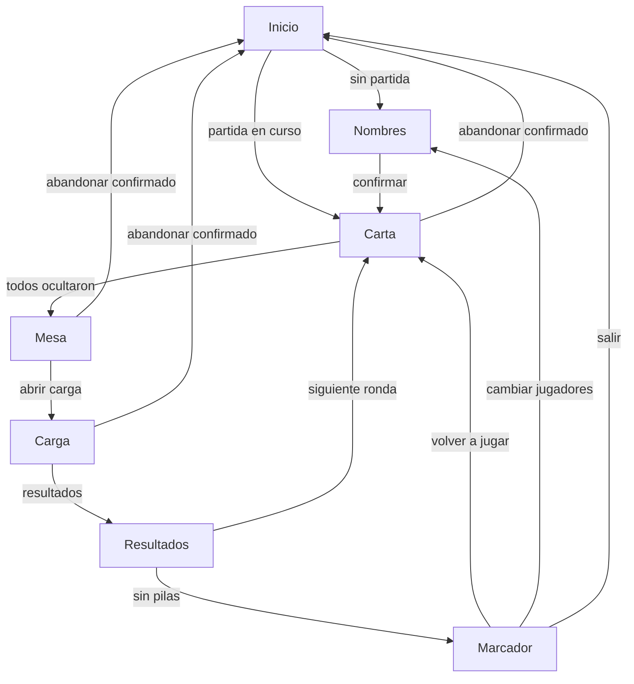

# Auditoría de UI del modo presencial

Auditoría del 17 de octubre de 2026. Describe lo que las pantallas hacen hoy. No cambia código, no agrega dependencias y no marca épicas. Las reglas siguen en [GAME_DESIGN_DOCUMENT.md](GAME_DESIGN_DOCUMENT.md). La navegación prevista está en [NAVEGACION_PRESENCIAL.md](NAVEGACION_PRESENCIAL.md).

Regla confirmada: los jugadores solo se agregan, editan o eliminan antes de iniciar la partida. No es una decisión abierta. `LocalSetupScreen` ya lo cumple: Editar y Quitar están solo antes de Confirmar. Carta, Mesa, Carga y Resultados no ofrecen esas acciones. El bloqueo también está en el módulo: si la fase no es `setup` o ya hay pilas o rondas, agregar, renombrar y quitar devuelven el mismo documento.

## 1. Inventario de pantallas

Hay un solo stack en `mobile/src/navigation/AppNavigator.tsx`. La carta, el voto y el nombre no viajan en la ruta. Los textos compartidos están en `mobile/src/features/local/match/copy.ts`. El color y el tipo están en `mobile/src/theme/theme.ts`: fondo blanco, texto `#1a1a1a`, acción `#1f4b99`, cuerpo de 16 y título de 28.

| Pantalla | Archivo | Fase | Qué ofrece |
|---|---|---|---|
| Inicio | `mobile/src/screens/HomeScreen.tsx` | — | Crear sala, Unirse, Partida presencial, Componentes. |
| Nombres | `mobile/src/screens/LocalSetupScreen.tsx` | `setup` | Agregar, Guardar, Editar, Quitar, Revisar, Confirmar, Volver, Cancelar, Inicio. |
| Carta | `mobile/src/screens/LocalCardScreen.tsx` | `viewing` | Turno, Ver carta, Ocultar, Continuar, Inicio; se cubre al ir a segundo plano. |
| Mesa | `mobile/src/screens/LocalTableScreen.tsx` | `conversation` | Abrir carga, Inicio. |
| Carga | `mobile/src/screens/LocalRecordScreen.tsx` | `recording` | Cubierta Continuar; Abrir, Señalar, Puño, V, Guardar, Confirmar, Cerrar, Resultados, Inicio. |
| Resultados y marcador | `mobile/src/screens/LocalResultsScreen.tsx` | `results` o `finished` | Una fila por persona (rol, carta, gesto, ronda/total); clasificación por puntos; Siguiente ronda o Volver a jugar / Cambiar jugadores; Inicio. |

Resultados y marcador final son la misma pantalla. El título sale de `localResultsCopy`: «Resultados» mientras quedan pilas y «Marcador» cuando la partida terminó.

Nombres, Carta, Mesa, Carga y Resultados ofrecen «Abandonar partida» con confirmación: borra el documento y vuelve a Inicio. Carta, Mesa, Carga y Resultados intermedios ofrecen «Reiniciar partida». El marcador final ofrece «Volver a jugar» y «Cambiar jugadores». «Inicio» no abandona. No hay descartar un archivo inválido ni una revancha reglamentaria aparte de volver a jugar.

## 2. Hallazgos funcionales

### Inicio

«Partida presencial» abre Nombres si no hay documento. Si el proceso todavía tiene la partida, vuelve a la fase guardada, también si ya terminó. Tras abandonar, la recuperación queda ausente y el botón vuelve a abrir Nombres. Si la recuperación falla, muestra «No se puede reanudar la partida.» y deshabilita el botón. No hay una acción para descartar un documento inválido.

### Nombres

Se pueden agregar, editar y quitar nombres antes de confirmar. Esa es la regla confirmada, y la pantalla ya la cumple. El orden de la lista es el orden en que se mira la carta. Menos de 4 no confirma. Más de 8 no agrega. Confirmar sortea 15 pilas de tres copias si hay 4 a 6 nombres, o 16 si hay 7 u 8, y abre Carta. Después de confirmar no se puede volver a editar la lista en esta partida.

### Carta

La carta empieza cubierta: indica «Turno de {nombre}» y «Pasá el teléfono a {nombre}. Solo esa persona toca Ver carta.» Ver carta muestra el número y el texto. Ocultar lo tapa y pasa a la persona siguiente. Cuando todos ocultaron, Continuar abre la mesa. Al reanudar `viewing`, la pasada vuelve a empezar cubierta. Al ir a segundo plano con la carta visible se cubre sin avanzar. Quien ya ocultó su carta no tiene un botón para verla otra vez.

### Mesa

La mesa no muestra cartas. El texto pide conversar y después abrir la carga. No hay manos levantadas ni «¡Basta!». El teléfono no comprueba `L × 2 > N`.

### Carga

Al entrar, Continuar precede a la lista. Cada nombre se abre para anotar Señalar, Puño o V. Señalar elige a otras personas de la lista. Confirmar exige una elección válida de cada persona. Cerrar calcula los puntos. Resultados abre la ronda ya puntuada. La carga muestra el gesto guardado, no el número ni el texto de la carta ni el rol.

### Resultados

Una fila por persona con badge de Equipo o Impostor, carta, gesto, explicación, puntos de la ronda (énfasis) y total (secundario). Debajo, clasificación ordenada por puntos. Si quedan pilas, «Siguiente ronda» reparte otra carta cubierta. Si no quedan, el título pasa a Marcador, muestra ganadores y ofrece «Volver a jugar» / «Cambiar jugadores».

### Cuatro salidas

| Intención | Qué hace la aplicación |
|---|---|
| Reiniciar conservando los nombres | Durante la partida: «Reiniciar partida». En el marcador: «Volver a jugar». |
| Administrar jugadores antes de una partida nueva | En Nombres antes de Confirmar, o «Cambiar jugadores» desde el marcador. |
| Abandonar y eliminar la partida activa | «Abandonar partida» borra el documento. Inicio deja el documento. |
| Volver a jugar tras finalizar | «Volver a jugar» reemplaza el documento activo y abre Carta. |

## 3. Hallazgos visuales

- Las cuatro acciones de Inicio tienen el mismo peso visual. «Partida presencial» no se distingue de Crear sala y Unirse.
- Nombres, Carta, Mesa, Carga y Resultados repiten el botón secundario Inicio al pie. No dice si pausa o borra.
- Resultados ya no duplica a cada persona ni iguala el estilo de ronda y total (OOC-019.9).
- La carta visible y la cubierta usan el mismo título de pantalla. La diferencia está en el texto de ayuda.
- Los íconos de la aplicación son la plantilla de Expo. `app.json` no declara la pantalla de inicio.
- El tema tiene superficies de peligro, aviso y éxito, y estas pantallas casi no las usan fuera del error de guardado.

## 4. Funcionalidades faltantes

- Descartar un documento que no se puede reanudar.
- Borrar el documento al salir del marcador. La especificación lo recomienda y la pantalla no lo hace.
- Un archivo que sobreviva al cierre del proceso. Hoy el puerto es el `Map` de `mobile/src/features/local/match/autosave.ts`.
- Ver otra vez la propia carta después de ocultarla.

Ya cubierto: reiniciar / abandonar / volver a jugar (OOC-019.6); pase privado con cubierta al segundo plano y cubierta Continuar en la carga (OOC-019.8).

## 5. Propuesta de navegación

No se agregan rutas en esta auditoría. La propuesta deja las fases actuales y separa cuatro salidas que hoy no existen:

«Siguiente ronda», abandonar, reiniciar, volver a jugar y cambiar jugadores ya existen. El diagrama refleja el cierre del marcador según OOC-019.6. No hay revancha reglamentaria aparte de volver a jugar.

## 6. Priorización

| Prioridad | Hallazgo |
|---|---|
| Bloqueante | Cerrar la aplicación pierde la partida. La especificación dice que se reanuda. |
| Alto | Inicio no dice si pausa o borra. En la práctica deja el documento. |
| Alto | No hay descartar un archivo inválido ni borrar al salir del marcador. |
| Alto | Un documento inválido deja el botón deshabilitado y no se puede descartar. |
| Medio | Quien ya ocultó su carta no puede volver a verla. La navegación lo deja abierto. |
| Bajo | Inicio no destaca la partida presencial frente a crear sala y unirse. |
| Bajo | Los íconos siguen siendo la plantilla de Expo. |

## 7. Recomendaciones para OOC-019.2 a OOC-019.10

OOC-019.6, OOC-019.8, OOC-019.9 y OOC-019.10 quedaron formalizados en el backlog. El resto sigue como corte propuesto. Inicio/atrás/descartar inválido y la pasada visual de Inicio quedan abiertos. Informe de regresión: `docs/OOC-019_REGRESSION_REPORT.md`.

| Historia | Alcance propuesto |
|---|---|
| OOC-019.2 | Cubierto por OOC-019.8: pase de carta con cubierta, Ver, Ocultar y paso al siguiente. |
| OOC-019.3 | Mesa: dejar claro que la conversación es física y que no hay manos ni «¡Basta!». |
| OOC-019.4 | Cubierto por OOC-019.8: carga con gestos, revisión, cubierta Continuar y paso a resultados. |
| OOC-019.5 | Cubierto por OOC-019.9: resultados sin repetir persona; ronda vs total; Siguiente ronda. |
| OOC-019.6 | DONE: volver a jugar con los mismos nombres, cambiar jugadores desde el marcador, reiniciar y abandonar. Borrar al salir del marcador sigue abierto. Sin revancha reglamentaria. |
| OOC-019.7 | Recuperación de la partida activa. El archivo en disco y el `Map` del proceso son una decisión aparte. |
| OOC-019.8 | DONE: reparto privado y votación física (turno, Ver/Ocultar, AppState, cubierta de carga, gestos sin roles). |
| OOC-019.9 | DONE: resultados y clasificación (una fila, badges, puntos diferenciados, ranking por puntos, ganadores). |
| OOC-019.10 | DONE: regresión/integración de la épica (17 escenarios, calidad mobile, informe GO condicionado). |
| (abierto) | Inicio y el atrás del sistema: pausar o abandonar, y descartar un documento inválido. |
| (abierto) | Claridad visual de Inicio, contraste y estados de error genéricos (antes mezclado con OOC-019.10). |

## Riesgos de privacidad

Varios puntos quedaron cubiertos por OOC-019.8; el resto sigue abierto.

- La carta permanece cubierta hasta que esa persona toca Ver carta. Ocultar la tapa antes de pasar el teléfono.
- Al reanudar `viewing`, la pasada vuelve a empezar oculta. No se restaura una carta que estaba visible.
- Al ir a segundo plano con la carta visible se cubre sin avanzar el turno.
- La carga pide Continuar antes de mostrar gestos. No muestra el número ni el texto de la carta.
- Resultados y el marcador muestran el número y el texto de la ronda ya puntuada. Eso es la revelación de la ronda, no la carta de la pasada.
- Quien ya ocultó su carta no tiene un botón para verla otra vez. Sigue abierto si debe tenerlo.
- La partida vive en un `Map` del proceso. Cerrar la aplicación la pierde. No queda un archivo de cartas en el teléfono.
- Si ya hay una sesión de invitado de una sala online, el cascarón abre un socket aunque la pantalla sea la presencial. Las pantallas locales no leen ese token ni dibujan la carta a partir del socket.

## Decisiones que siguen abiertas

- «Inicio», con una partida activa, solo vuelve al menú; no abandona. Abandonar es la acción que borra.
- Reiniciar y volver a jugar conservan los nombres y reparte otra partida tras confirmar. Cambiar jugadores abre Nombres.
- No hay revancha reglamentaria aparte de volver a jugar.
- Cuándo se borra el documento: al salir del marcador, al pasar a `finished`, o solo al abandonar.
- Si quien ya ocultó su carta puede verla otra vez.
- Si la partida debe sobrevivir al cierre del proceso. Hoy no sobrevive, y no se agrega un paquete de archivos en esta auditoría.
